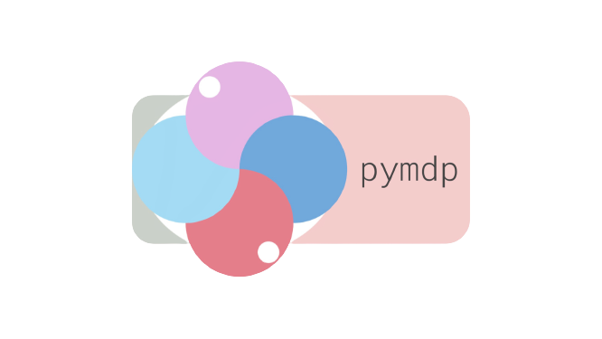
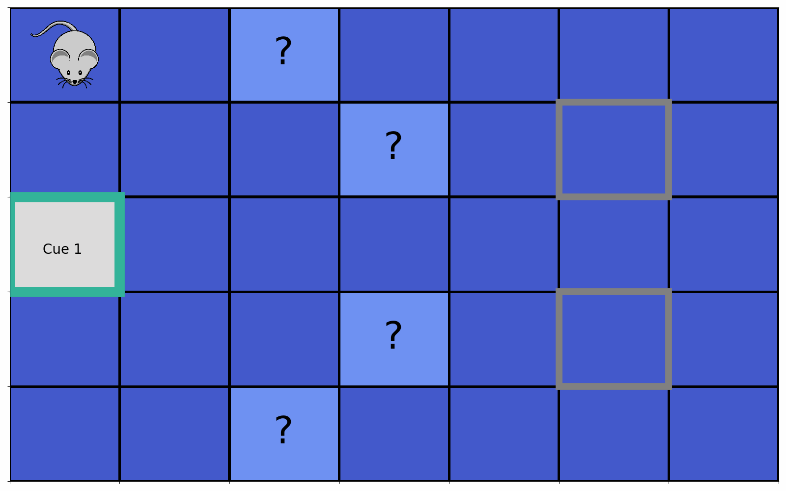

<p align='center'>
  <a href='https://github.com/infer-actively/pymdp'>
    
  </a> 
</p>

A Python package for simulating Active Inference agents in Markov Decision Process environments.
Please see our companion paper, published in the Journal of Open Source Software: ["pymdp: A Python library for active inference in discrete state spaces"](https://joss.theoj.org/papers/10.21105/joss.04098) for an overview of the package and its motivation. For a more in-depth, tutorial-style introduction to the package and a mathematical overview of active inference in Markov Decision Processes, see the [longer arxiv version](https://arxiv.org/abs/2201.03904) of the paper.

> **Fork notice.** This checkout is the Active Inference Institute fork
> (`ActiveInferenceInstitute/pymdp`, default branch `master`) of
> [`infer-actively/pymdp`](https://github.com/infer-actively/pymdp). Fork-local
> additions stay additive; see [`AGENTS.md`](AGENTS.md) and [`TODO.md`](TODO.md).

## Contents

- [Project status](#project-status)
- [Documentation](#documentation)
- [Citing `pymdp`](#citing-pymdp)
- [Quick-start: Installation and Usage](#quick-start-installation-and-usage)
- [Getting started / introductory material](#getting-started--introductory-material)
- [Publishing models as Generalized Notation Notation (GNN)](#publishing-models-as-generalized-notation-notation-gnn)
- [Contributing](#contributing)
- [Contributors](#contributors)

## Project status

`pymdp` is released and actively developed. The default backend since 1.0.0 is
**JAX**; the archived NumPy implementation lives under `pymdp/legacy/` for
migration and cross-validation. Everything below runs locally once the declared
dependencies are installed (`uv sync --group test`).

- **Gates:** one entry point, `./gate.sh <arm>`; the unit gate is
  `./gate.sh test` (nightly tests and the notebook suite are separate arms).
  Arms are listed in [`docs-mkdocs/development/testing.md`](docs-mkdocs/development/testing.md).
- **Docs:** source lives in [`docs-mkdocs/`](docs-mkdocs/README.md) and builds
  with `./gate.sh docs` (notebook sync + strict mkdocs).
- **Network/credentials:** none required for install, tests, or a docs build.
- **GNN interop:** `test/test_gnn_bridge.py` is opt-in and needs an exported GNN
  tree (`PYMDP_GNN_ROOT`); it skips cleanly otherwise.

## Documentation

The published site is <https://pymdp-rtd.readthedocs.io/en/latest/>; its source
is the [`docs-mkdocs/`](docs-mkdocs/README.md) tree.

- [Docs source index](docs-mkdocs/index.md)
- [Installation](docs-mkdocs/getting-started/installation.md)
- [Quickstart (JAX)](docs-mkdocs/getting-started/quickstart-jax.md)
- [Generative model structure](docs-mkdocs/guides/generative-model-structure.md)
- [NumPy/legacy to JAX migration](docs-mkdocs/migration/numpy-to-jax.md)
- [GNN interoperability](docs-mkdocs/guides/gnn-interoperability.md)
- [Testing](docs-mkdocs/development/testing.md)
- [API reference](docs-mkdocs/api/index.md)

## Citing `pymdp`
If you use `pymdp` in your work or research, please cite:

```
@article{Heins2022,
  doi = {10.21105/joss.04098},
  url = {https://doi.org/10.21105/joss.04098},
  year = {2022},
  publisher = {The Open Journal},
  volume = {7},
  number = {73},
  pages = {4098},
  author = {Conor Heins and Beren Millidge and Daphne Demekas and Brennan Klein and Karl Friston and Iain D. Couzin and Alexander Tschantz},
  title = {pymdp: A Python library for active inference in discrete state spaces},
  journal = {Journal of Open Source Software}
}
```

This package is hosted on the [`infer-actively`](https://github.com/infer-actively) GitHub organization, which was built with the intention of hosting open-source active inference and free-energy-principle related software.

Most of the low-level mathematical operations are [NumPy](https://github.com/numpy/numpy) ports of their equivalent functions from the `SPM` [implementation](https://www.fil.ion.ucl.ac.uk/spm/doc/) in MATLAB. We have benchmarked and validated most of these functions against their SPM counterparts.

## Status


[](https://pypi.org/project/inferactively-pymdp/1.0.0/)
[](https://pymdp-rtd.readthedocs.io/en/latest/)
[](https://doi.org/10.21105/joss.04098)


# ``pymdp`` in action

Here's a visualization of ``pymdp`` agents in action. One of the defining features of active inference agents is the drive to maximize "epistemic value" (i.e. curiosity). Equipped with such a drive in environments with uncertain yet disclosable hidden structure, active inference can ultimately allow agents to simultaneously learn about the environment as well as maximize reward.

The simulation below (see associated JAX notebook [here](https://pymdp-rtd.readthedocs.io/en/latest/tutorials/notebooks/examples/envs/cue_chaining_demo/)) demonstrates what might be called "epistemic chaining," where an agent (here, analogized to a mouse seeking food) forages for a chain of cues, each of which discloses the location of the subsequent cue in the chain. The final cue (here, "Cue 2") reveals the location a hidden reward. This is similar in spirit to "behavior chaining" used in operant conditioning, except that here, each successive action in the behavioral sequence doesn't need to be learned through instrumental conditioning. Rather, active inference agents will naturally forage the sequence of cues based on an intrinsic desire to disclose information. This ultimately leads the agent to the hidden reward source in the fewest number of moves as possible.

You can run the code behind simulating tasks like this one and others in the **Examples** section of the [official documentation](https://pymdp-rtd.readthedocs.io/en/latest/). The GIF generation script used for these animations is available [here](examples/envs/chained_cue_navigation.py).

<!-- 
<p align="center">
  
  
</p> -->

<!--  |  -->

<table><tr>
<td> 
  <p align="center" style="padding: 10px">
    
    <br>
    <em style="color: grey">Cue 2 in Location 1, Reward on Top</em>
  </p> 
</td>
<td> 
  <p align="center">
    
    <br>
    <em style="color: grey">Cue 2 in Location 3, Reward on Bottom</em>
  </p> 
</td>
</tr></table>

## Quick-start: Installation and Usage

We recommend installing `pymdp` using [`uv`](https://docs.astral.sh/uv/), with an explicit virtual environment:

```bash
uv venv .venv
source .venv/bin/activate
uv pip install inferactively-pymdp
```

If you prefer `pip`, use:

```bash
pip install inferactively-pymdp
```

If `uv sync --group test` or `uv sync --extra nb` fails while building `pygraphviz`, install Graphviz first and then retry. On macOS, install `graphviz` with Homebrew. On Ubuntu/Debian, install `graphviz libgraphviz-dev pkg-config build-essential python3-dev` (or the version-matched `python3.x-dev` package if needed). The full troubleshooting notes live in [`docs-mkdocs/getting-started/installation.md`](docs-mkdocs/getting-started/installation.md).

Once in Python, you can then directly import `pymdp`, its sub-packages, and functions.

```python
from jax import numpy as jnp, random as jr
from pymdp import utils
from pymdp.agent import Agent

key = jr.PRNGKey(0)
keys = jr.split(key, 3)

num_obs = [3, 5]
num_states = [3, 2]
num_controls = [3, 1]

A = utils.random_A_array(keys[0], num_obs, num_states)
B = utils.random_B_array(keys[1], num_states, num_controls)
C = utils.list_array_uniform([[no] for no in num_obs])

agent = Agent(A=A, B=B, C=C, batch_size=1)
observation = [jnp.array([1]), jnp.array([4])]

qs, info = agent.infer_states(observation, empirical_prior=agent.D, return_info=True)
# Optional diagnostic: current variational free energy for each batch element.
vfe = info["vfe"]
q_pi, neg_efe = agent.infer_policies(qs)

action_keys = jr.split(keys[2], agent.batch_size + 1)
action = agent.sample_action(q_pi, rng_key=action_keys[1:])
```

## Getting started / introductory material

We recommend starting with the JAX-first [official documentation](https://pymdp-rtd.readthedocs.io/en/latest/) for the repository, which provides practical guides, curated notebooks, and generated API references.

For new users to `pymdp`, we specifically recommend stepping through following three Jupyter notebooks (can also be used on Google Colab):

- [Quickstart (JAX)](https://pymdp-rtd.readthedocs.io/en/latest/getting-started/quickstart-jax/)
- [NumPy/legacy to JAX migration guide](https://pymdp-rtd.readthedocs.io/en/latest/migration/numpy-to-jax/)
- [`rollout()` active inference loop guide](https://pymdp-rtd.readthedocs.io/en/latest/guides/rollout-active-inference-loop/)

We also have (and are continuing to build) a series of notebooks that walk through active inference agents performing different types of tasks in the [Notebook Gallery](https://pymdp-rtd.readthedocs.io/en/latest/tutorials/notebooks/).

## Publishing models as Generalized Notation Notation (GNN)

`pymdp` generative models can be published as [Generalized Notation Notation](https://github.com/ActiveInferenceInstitute/Generalized_Notation_Notation) (GNN) specifications — the plain-text language for Active Inference generative models — and validated against the real GNN parser pinned at GNN v5.0.3 (revision `8f293d9ba810e6eda5c09842d9c7ed9ffa5f92c1`):

```python
from pymdp import gnn

spec = gnn.to_gnn_spec(agent, name="three_state_agent")  # GNN Markdown text
path = gnn.write_gnn_spec("three_state_agent.gnn.md", agent, name="three_state_agent")

report = gnn.validate_gnn_spec(agent, path)  # needs PYMDP_GNN_ROOT; see the guide
assert report.ok, report.describe()
```

`validate_gnn_spec` re-parses the emitted file with the pinned GNN parser and compares every matrix, declared dimension and model parameter against the source arrays; GNN can then render and execute the specification through its own pymdp route. The [GNN interoperability guide](docs-mkdocs/guides/gnn-interoperability.md) documents the pinned-tree export, the round trip through GNN's renderer and executor, and the model class the bridge covers. GNN also maintains a [downstream adoption guide](https://github.com/ActiveInferenceInstitute/Generalized_Notation_Notation/blob/main/docs/gnn/integration/downstream_adoption.md) for repositories that consume it.

Other repositories that specify or consume models in GNN:

- [`active_inference_battleship`](https://github.com/ActiveInferenceInstitute/active_inference_battleship) — a playable model specified in GNN and compiled at build time.
- [`active_inference_language_model`](https://github.com/ActiveInferenceInstitute/active_inference_language_model) — a language-model stack with GNN specifications and conformance checks.
- [`ActiveBlockference`](https://github.com/ActiveInferenceInstitute/ActiveBlockference) and [`ActInf_RxInfer`](https://github.com/ActiveInferenceInstitute/ActInf_RxInfer) — block-based and RxInfer implementations in the same ecosystem.

## Contributing

This package is under active development. If you would like to contribute, please refer to [CONTRIBUTING.md](CONTRIBUTING.md).

Recommended local setup:

```bash
cd <path_to_repo_fork>
uv venv .venv
source .venv/bin/activate
uv sync --group test
```

Recommended contributor hooks:

```bash
uv sync --group dev
uv run --group dev pre-commit install
```

Useful variants:

```bash
# tests + contributor hooks
uv sync --group test --group dev

# docs work
uv sync --group test --extra docs

# notebook/media extras
uv sync --group test --extra nb

# model fitting extras
uv sync --group test --extra modelfit
```

Run the gates:

```bash
./gate.sh test    # unit gate (nightly tests deselected)
./gate.sh docs    # strict mkdocs build
./gate.sh all     # everything except the nightly tier
```

Every arm is documented in [`AGENTS.md`](AGENTS.md) and
[`docs-mkdocs/development/testing.md`](docs-mkdocs/development/testing.md);
measured arm times live in the generated
[`docs-mkdocs/development/gate-metrics.md`](docs-mkdocs/development/gate-metrics.md).

## Contributors

- Conor Heins [@conorheins](https://github.com/conorheins)
- Tim Verbelen [@tverbele](https://github.com/tverbele)
- Dimitrije Markovic [@dimarkov](https://github.com/dimarkov)
- Riddhi Jain Pitliya [@riddhipits](https://github.com/riddhipits)
- Arun Niranjan [@Arun-Niranjan](https://github.com/Arun-Niranjan)
- Toon Van de Maele [@toonvdm](https://github.com/toonvdm)
- Ozan Catal [@OzanCatalVerses](https://github.com/OzanCatalVerses)
- Tommaso Salvatori [@salvatomm](https://github.com/salvatomm)
- Aswin Paul [@aswinpaul](https://github.com/aswinpaul)
- Lancelot Da Costa [@lancelotdacosta](https://github.com/lancelotdacosta)
- Ran Wei [@ran-weii](https://github.com/ran-weii)
- Alexander Tschantz [@alec-tschantz](https://github.com/alec-tschantz)
- Miguel de Prado [@praesc](https://github.com/praesc)
- Nikola Pižurica [@NIkolaPizurica](https://github.com/NIkolaPizurica)
- Nikola Milović [@nikolamilovic-ft](https://github.com/nikolamilovic-ft)
- Matteo Risso [@matteorisso](https://github.com/matteorisso)
- Christopher Buckley [@clb27](https://github.com/clb27)
- Beren Millidge [@BerenMillidge](https://github.com/BerenMillidge)
- Daphne Demekas [@daphnedemekas](https://github.com/daphnedemekas)
- Cooper Williams [@coopwilliams](https://github.com/coopwilliams)

## InstituteOS sidecar

This repository carries a committed [`.aii/`](.aii/README.md) sidecar with curated
InstituteOS metadata (`aii-sidecar/v1`): category, maturity, ecosystem relations,
key artifacts, provenance, and portable tasks. It is read by
[InstituteOS](https://github.com/ActiveInferenceInstitute/InstituteOS) tooling and
does not affect the project's build or runtime.
